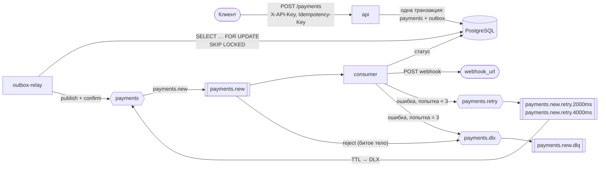

# Payment Service

Микросервис асинхронной обработки платежей. API принимает платёж и сразу отвечает `202 Accepted`. Фоновый consumer прогоняет платёж через эмуляцию шлюза, сохраняет статус и уведомляет клиента webhook-ом. Событие о новом платеже публикуется через transactional outbox. Ошибки доставки повторяются с экспоненциальной задержкой, а после трёх попыток сообщение уходит в dead letter queue.

## Стек

- Python 3.12, Poetry
- FastAPI, Pydantic v2
- SQLAlchemy 2.1 (async) и asyncpg, Alembic
- PostgreSQL 16
- RabbitMQ 4 через FastStream 0.7 (aio-pika)
- httpx для webhook
- pytest, ruff, mypy, Docker Compose

## Как устроено



Процессы (все из одного образа):

| Сервис | Что делает |
| --- | --- |
| `api` | FastAPI. Пишет платёж и событие в outbox одной транзакцией. С RabbitMQ не общается вообще. |
| `outbox-relay` | Читает неопубликованные строки outbox, публикует их в RabbitMQ и после подтверждения брокера помечает `published_at`. |
| `consumer` | Единственный обработчик `payments.new`: шлюз → статус в БД → webhook → при ошибке retry или DLQ. |
| `webhook-sink` | Тестовый приёмник webhook для e2e и ручной проверки. |

Код разложен по слоям, как в остальных наших сервисах. Роутер (`api/`) знает только схемы и коды ответа. Сервис (`services/`) держит правила. Репозиторий (`repositories/`) собирает SQL. Всё про RabbitMQ — топология, повторы, публикация — лежит в `messaging/`, а точки входа воркеров — в `workers/`.

## Гарантии

### Outbox

`POST /payments` в одной транзакции вставляет строку в `payments` и событие в `outbox`. Либо есть и то и другое, либо ничего — потерять событие при падении между записью в БД и публикацией нельзя.

Relay берёт пачку строк через `FOR UPDATE SKIP LOCKED`, поэтому несколько реплик relay не мешают друг другу. Публикует с publisher confirms, `mandatory=True` и `on_return_raises=True`. Последнее значит, что `publish()` вернётся только после того, как RabbitMQ положил сообщение в очередь; если сообщение не удалось никуда направить, вылетит исключение. Только после этого строка получает `published_at` — в той же транзакции, что держит блокировку. Ошибка публикации увеличивает `attempts`, пишет `last_error` и останавливает пачку до следующего опроса.

Если relay упадёт между подтверждением брокера и коммитом, событие опубликуется повторно. Доставка at-least-once, consumer к дублям готов. `message_id` сообщения равен id строки outbox.

Проверено руками: при остановленном RabbitMQ API продолжает отвечать `202`, события копятся в outbox с растущим `attempts`, после старта брокера relay их публикует, платёж обрабатывается.

### Идемпотентность API

Заголовок `Idempotency-Key` обязателен, на колонке стоит уникальный индекс. Вставка идёт через `INSERT … ON CONFLICT DO NOTHING RETURNING id`:

- новый ключ — платёж и событие в outbox, `202`;
- тот же ключ и то же тело — `202` с тем же `payment_id` и заголовком `Idempotent-Replayed: true`, второго события нет;
- тот же ключ, другое тело — `409 idempotency_key_reused`.

Параллельные запросы с одним ключом сериализуются на уникальном индексе: второй ждёт коммита первого и получает конфликт без ошибки. Есть unit-тест на пять одновременных запросов.

### Идемпотентность consumer

Сообщение может прийти повторно: дубль от relay, повтор после ошибки, redelivery после падения consumer до ack. Поэтому каждый шаг безопасен для повтора:

- шлюз вызывается под `SELECT … FOR UPDATE` и только для `pending`; дубль в соседнем consumer дождётся коммита и увидит конечный статус — второго списания не будет;
- после успешного webhook ставится `webhook_delivered_at`, и повторное сообщение уже ничего не шлёт;
- на повторе после ошибки webhook шлюз не вызывается: статус уже сохранён, повторяется только доставка.

Клиент всё равно должен дедуплицировать webhook по `payment.id` — at-least-once.

### Retry и DLQ

Отказ шлюза (10% случаев) — это бизнес-результат: платёж `failed`, клиенту уходит `payment.failed`. Повторяются ошибки обработки, прежде всего ошибки доставки webhook: сеть, таймаут, ответ не `2xx` (редиректы не выполняются).

| Попытка | Когда | Куда при ошибке |
| --- | --- | --- |
| 1 | сразу | `payments.new.retry.2000ms` |
| 2 | через 2 с | `payments.new.retry.4000ms` |
| 3 | ещё через 4 с | `payments.new.dlq` |

Повтор — это новая публикация исходного тела в обменник `payments.retry` с заголовками `x-attempt` и `x-last-error`. Исходное сообщение после этого подтверждается. Очередь задержки не имеет потребителей: по истечении TTL RabbitMQ сам возвращает сообщение через DLX в `payments` → `payments.new`. Ни один consumer не блокируется на `sleep`, и задержка переживает рестарт.

На каждую задержку — своя очередь. TTL на уровне очереди не страдает от блокировки головы, которая бывает при TTL на отдельных сообщениях. Задержка входит в имя очереди: аргументы существующей очереди менять нельзя, и смена `RETRY_BASE_DELAY` просто создаст новую очередь вместо ошибки `PRECONDITION_FAILED`.

Сообщение, которое не разбирается в схему события, consumer отклоняет (`AckPolicy.REJECT_ON_ERROR`), и брокер через `x-dead-letter-exchange` основной очереди кладёт его в ту же DLQ. Отличить такие сообщения можно по заголовку `x-death` с `reason: rejected`.

Число попыток и базовая задержка задаются через `RETRY_MAX_ATTEMPTS` и `RETRY_BASE_DELAY`.

## Запуск

```bash
make up
```

Контейнер `migrate` накатывает миграции и завершается; `api`, `outbox-relay`, `consumer` стартуют после его успешного выхода. Топологию RabbitMQ объявляют и relay, и consumer при старте — порядок запуска не важен.

- API и Swagger: http://localhost:8000/docs (кнопка Authorize → `X-API-Key`)
- RabbitMQ management: http://localhost:15672, `guest` / `guest`
- webhook-sink: http://localhost:8081
- API-ключ по умолчанию: `dev-only-api-key-change-me`

Порты меняются переменными `API_PORT`, `RABBITMQ_PORT`, `RABBITMQ_MANAGEMENT_PORT`, `WEBHOOK_SINK_PORT`, `POSTGRES_PORT` (например, в `.env` рядом с `docker-compose.yml`). PostgreSQL живёт только во внутренней сети `data` и с хоста недоступен.

```bash
make test-unit
make test-e2e
make lint
make logs      # api, outbox-relay, consumer
make down      # остановить и удалить volumes
```

Горизонтальное масштабирование: `docker compose up -d --scale consumer=3 --scale outbox-relay=2`. Один consumer обрабатывает сообщения последовательно (шлюз 2–5 с), так что пропускная способность растёт репликами.

Локально без Docker, когда PostgreSQL и RabbitMQ уже запущены:

```bash
poetry install
cp .env.example .env
poetry run alembic upgrade head
PYTHONPATH=src poetry run uvicorn payments.main:app --reload
PYTHONPATH=src poetry run faststream run payments.workers.relay:app
PYTHONPATH=src poetry run faststream run payments.workers.consumer:app
```

## Примеры

```bash
API=http://localhost:8000/api/v1
KEY='X-API-Key: dev-only-api-key-change-me'
```

Создать платёж. Адрес `webhook-sink` указан так, как его видит consumer внутри Compose:

```bash
curl -i -X POST "$API/payments" \
  -H "$KEY" -H 'Idempotency-Key: order-42' -H 'Content-Type: application/json' \
  -d '{
        "amount": "1500.00",
        "currency": "RUB",
        "description": "Order #42",
        "metadata": {"order_id": 42},
        "webhook_url": "http://webhook-sink:8080/hooks/demo"
      }'
```

```http
HTTP/1.1 202 Accepted
location: /api/v1/payments/2f6c1a8e-...
x-request-id: ...

{"payment_id": "2f6c1a8e-...", "status": "pending", "created_at": "2026-11-17T11:15:17.724980Z"}
```

Повтор той же командой вернёт тот же `payment_id` и `Idempotent-Replayed: true`. Тот же ключ с другой суммой — `409`:

```json
{"detail": "Idempotency key was already used with a different request body", "code": "idempotency_key_reused", "request_id": "..."}
```

Через 2–5 секунд:

```bash
curl -s "$API/payments/<payment_id>" -H "$KEY"
```

```json
{
  "id": "2f6c1a8e-...",
  "amount": "1500.00",
  "currency": "RUB",
  "description": "Order #42",
  "metadata": {"order_id": 42},
  "status": "succeeded",
  "idempotency_key": "order-42",
  "webhook_url": "http://webhook-sink:8080/hooks/demo",
  "created_at": "2026-11-17T11:15:17.724980Z",
  "processed_at": "2026-11-17T11:15:21.104311Z"
}
```

Что получил клиент:

```bash
curl -s http://localhost:8081/hooks/demo
```

```json
{"calls": [{
  "headers": {"content-type": "application/json", "x-event-type": "payment.succeeded", "x-payment-id": "2f6c1a8e-..."},
  "body": {"event": "payment.succeeded", "payment": {"id": "2f6c1a8e-...", "status": "succeeded", "...": "..."}}
}]}
```

Retry и DLQ: приёмник отвечает `500` на любой путь `/hooks/fail-*`. Создайте платёж с `"webhook_url": "http://webhook-sink:8080/hooks/fail-demo"`. В `make logs` будут попытки 1/3 и 2/3 с задержками 2 и 4 секунды и перенос в DLQ. `curl -s localhost:8081/hooks/fail-demo` покажет три вызова, а сообщение с заголовками `x-attempt: 3` и `x-last-error` лежит в очереди `payments.new.dlq` (management UI → Queues → Get messages).

Без ключа или с неверным ключом — `401`:

```json
{"detail": "X-API-Key header is required", "code": "api_key_missing", "request_id": "..."}
```

## API

Префикс `/api/v1`, на всех ручках обязателен `X-API-Key`. Пробы `GET /health` и `GET /ready` (проверяет БД) открыты для healthcheck оркестратора. `GET /` ведёт на `/docs`.

| Метод | Путь | Ответ |
| --- | --- | --- |
| POST | `/payments` | `202` `{payment_id, status, created_at}`, заголовки `Location` и при повторе `Idempotent-Replayed` |
| GET | `/payments/{payment_id}` | `200` полная карточка платежа |

Тело создания:

| Поле | Тип | Правила |
| --- | --- | --- |
| `amount` | decimal (строка или число) | `> 0`, не больше 2 знаков после запятой, до 16 знаков в целой части |
| `currency` | `RUB`, `USD`, `EUR` | обязательно |
| `description` | строка | необязательно, до 1000 символов, пустая строка сохраняется как `null` |
| `metadata` | объект JSON | необязательно, до 16 КБ |
| `webhook_url` | URL `http`/`https` | обязательно |

Лишние поля отклоняются. Сумма в ответах — строка (`"1500.00"`), чтобы не терять точность во float. Ошибки приходят как `{"detail", "code", "request_id"}`, у `422` есть ещё `errors`.

Webhook — `POST` JSON `{"event": "payment.succeeded" | "payment.failed", "payment": {…как в GET…}}` с заголовками `X-Event-Type` и `X-Payment-Id`. Успехом считается любой `2xx` за `WEBHOOK_TIMEOUT` секунд.

## Схема данных

`payments` — платёж. CHECK-ограничения держат инварианты на стороне БД: `amount > 0`; `processed_at` заполнен тогда и только тогда, когда статус не `pending`; `webhook_delivered_at` бывает только у обработанного платежа. `idempotency_key` уникален.

`outbox` — `id` (он же `message_id` и `event_id`), `event_type` (= routing key), `aggregate_id`, `payload` JSONB, `created_at`, `published_at`, `attempts`, `last_error`. Частичный индекс `WHERE published_at IS NULL` держит запрос relay быстрым при любом объёме истории.

## Тесты

- **unit** (`tests/unit`, 48 тестов): ASGI-клиент и та же PostgreSQL, после каждого теста `TRUNCATE`. RabbitMQ и HTTP подменены фейками. Проверяют API и идемпотентность (в том числе параллельные запросы), запись outbox в той же транзакции, relay (успех, ошибка брокера, размер пачки), обработку (статусы, повторная доставка, параллельные дубли без двойного списания), маршрутизацию retry/DLQ, HTTP-отправку webhook и соответствие моделей миграциям (`alembic check`).
- **e2e** (`tests/e2e`, 16 тестов): только HTTP к живому стенду, без доступа к БД. Полный путь outbox → RabbitMQ → consumer → webhook; три попытки на падающий webhook и сообщение в DLQ (через management API RabbitMQ); отклонение нечитаемого сообщения в DLQ; идемпотентность, авторизация, валидация.

Контейнеры `tests-unit` и `tests-e2e` подняты рядом и ждут команды. `src`/`tests` примонтированы, так что править код и тесты можно без пересборки.

## Coverage и CI

```bash
make coverage
```

Overlay `docker-compose.coverage.yml` запускает `api`, `outbox-relay` и `consumer` под `coverage run`. Unit пишет покрытие в своём процессе, e2e — в процессах сервисов. Итог склеивается в `htmlcov/index.html` и `coverage.xml`. В GitLab CI (`.gitlab-ci.yml`) те же шаги разнесены по stage: `lint` → `unit` → `e2e` → `coverage` с порогом 80%.

## Миграции

```bash
docker compose exec api alembic revision --autogenerate -m "describe the change"
make migrate
```

## Переменные

Смотрите `.env.example`; в Compose значения по умолчанию уже подставлены. В `production` нельзя оставить API-ключ со строкой `dev-only`.

## Что осознанно упрощено

- Один статический API-ключ, поэтому `Idempotency-Key` уникален глобально. С несколькими клиентами ключ стал бы уникален в паре `(client_id, idempotency_key)`.
- `webhook_url` не проверяется на внутренние адреса — иначе не работал бы `webhook-sink` в Compose. В проде нужна защита от SSRF (запрет приватных сетей, egress-прокси) и подпись тела HMAC-ом, чтобы клиент мог проверить отправителя.
- Опубликованные строки outbox не удаляются. В проде — периодическая чистка или партиционирование по `created_at`.
- Relay опрашивает таблицу раз в `OUTBOX_POLL_INTERVAL`. Задержку можно убрать через `LISTEN/NOTIFY`, оставив опрос как страховку.
- Очереди classic durable. Для отказоустойчивого кластера — quorum queues.
- Блокировка строки держится на время вызова шлюза (2–5 с). Для настоящего шлюза правильнее передавать ему `payment.id` как ключ идемпотентности и не держать транзакцию на время сетевого вызова.
